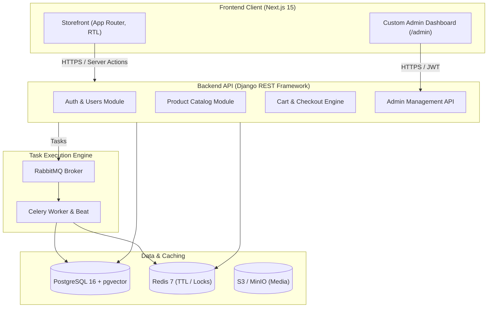

# Full-Stack Online Shop

Modern, distributed, production-grade e-commerce platform built with Next.js 15, Django REST Framework, PostgreSQL, Redis, RabbitMQ, and Celery.

---

## Architecture Overview



---

## Tech Stack

- **Client**: Next.js 15 (React 19, TypeScript, Tailwind CSS, shadcn/ui, next-intl planned for RTL/fa-IR & LTR/en-US).
- **Interactive previews**: Native Three.js, loaded on demand for a bilingual PBR material lab; texture/model product previews follow the learning track.
- **Server API**: Python 3.12+ with Django REST Framework (DRF) (ViewSets, Serializers, Permissions, drf-spectacular for OpenAPI).
- **Primary Database**: PostgreSQL 16 (JSONB specifications, ACID transactions, `pgvector` semantic search).
- **Caching & Locks**: Redis 7 (OTP keys with 120s TTL, sliding rate limiter, distributed checkout locks).
- **Queue & Async Worker**: RabbitMQ 3.13 + Celery (Exponential backoff retries, Dead Letter Queue, scheduled Beat tasks).
- **Storage**: S3-compatible (SeaweedFS dev, Cloudflare R2 / AWS S3 prod) with presigned direct uploads.
- **Testing**: Pytest + Factory Boy for backend unit/integration tests; Vitest for client unit tests; Playwright planned for E2E browser automation.

---

## Core Capabilities

1. **Atomic Checkout Engine**: Race-condition-free inventory locking with `SELECT ... FOR UPDATE`.
2. **Advanced Availability Rules**: Time-window constraints (e.g., even-day ordering windows), advance lead-time constraints relative to store operating hours, backed by precomputed summary tables.
3. **Role-Based Admin Panel**: Custom Next.js dashboard with granular permissions for Product Managers, Operators, Auditors, and Superadmins.
4. **Resilient Background Workers**: Idempotent payment webhook callbacks, automatic 15-minute unpaid order reservation release, DLQ routing.
5. **Full Internationalization (i18n)**: Native RTL layout, Persian (fa-IR) and English (en-US), Shamsi (Jalali) and Gregorian calendar support.

---

## Domain-driven design

Develop new business features using pragmatic **DDD**: shared business language, explicit domain ownership, and rules enforced in models/policies rather than repeated in endpoints. Keep one modular Django backend; no microservices or extra repository layers required.

Read [DDD guide and context map](./docs/domain-driven-design.md) for entities, value objects, aggregates, checkout transaction boundaries, worked learning steps, and task ownership. TASK-006 records this convention; TASK-007 resolves open business questions before catalog/checkout modeling. Domain apps are planned, not scaffolded or migrated yet.

## Custom admin and configurable shop

Next.js `/admin` + protected DRF APIs is the only staff panel; Django admin app/routes are disabled. Keep Django authentication and permissions. Every new model must ship its permitted staff screens/actions and tests alongside its backend slice; immutable audit/derived data is not unrestricted CRUD.

Planned `ShopSettings` singleton supplies localized branding, landing content, links/contact/footer and metadata. TASK-108/109 cover DB constraints, protected editor and dynamic storefront; TASK-110 adds About later. These features are specified, not implemented yet. Read [admin/settings contract](./docs/admin-and-shop-settings.md).

## Learn Three.js in this project

Start with the home page's **Material lab**: load a sphere, change color/roughness/metalness, and orbit with mouse or keyboard. No backend or external assets required. This is a learning sample, not a live product preview.

```sh
npm ci
npm --prefix client ci
npm run dev:client
```

Read [Three.js learning guide](./docs/threejs-learning.md) for a source-code tour, small experiments, verification commands, and the path from material sphere to texture inspector and GLB turntable. Follow `TASK-3D-001` through `TASK-3D-006` in [tasks.md](./tasks.md). Business-domain tasks remain unchanged.

## Testing

All three layers are required; integration and E2E are not interchangeable. Add tests alongside features, not only during final hardening.

| Layer | Purpose / tools | Current repository status |
| --- | --- | --- |
| Unit | Isolated business logic with Pytest; client logic and Three.js scene behavior with Vitest | Client Three.js tests exist; broader domain coverage remains planned |
| Integration | API/service boundaries, real PostgreSQL persistence/transactions and Redis behavior with Pytest + DRF APIClient | DB-backed BaseModel tests and mocked health endpoint tests exist; real Redis/worker/storage and business API coverage remain planned |
| E2E | User journeys in a real browser with Playwright against running client/API | Playwright dependency, configuration, and automated E2E suite are not yet added; earlier browser smoke checks are manual validation only |

Existing commands, from repository root:

```sh
npm --prefix client run test
(cd server && pytest -v --cov=.)
npm run test
```

Backend checks require installed Python dev dependencies and PostgreSQL test DB access; integration cases need their isolated services too. `npm run test` currently chains Vitest and Pytest, **not E2E**. `npx playwright test` from `client` is a future command after TASK-005 setup, not a working suite today.

Required coverage, isolation rules, and release gates: [testing guide](./docs/development/testing.md), [REQUIREMENTS.md](./REQUIREMENTS.md#phase-7-quality-assurance-hardening--deployment), and TASK-005 / TASK-701 / TASK-702 / TASK-705 in [tasks.md](./tasks.md).

## Documentation & Roadmap

- Agent instructions & conventions: [AGENTS.md](./AGENTS.md)
- Scoped instructions: [client](./client/AGENTS.md), [server](./server/AGENTS.md), [infrastructure](./infra/AGENTS.md); load relevant layers only
- Testing contract: [docs/development/testing.md](./docs/development/testing.md)
- Custom staff operations / singleton configuration: [docs/admin-and-shop-settings.md](./docs/admin-and-shop-settings.md)
- Detailed system architecture and business logic: [REQUIREMENTS.md](./REQUIREMENTS.md)
- Step-by-step implementation tasks and status: [tasks.md](./tasks.md)

---

## License

This project is licensed under the [MIT License](./LICENSE).

### Local S3 storage

SeaweedFS replaces the unavailable MinIO image. Start services with
`docker compose -f infra/docker-compose.yml up -d --wait`. The S3 endpoint remains
`http://localhost:9000`; the `shop-media` bucket is created automatically.
Configuration lives in the repository root `.env`. Copy `.env.example` to `.env`
on first setup. Django and Next.js load this shared file; only `NEXT_PUBLIC_`
variables are included in browser code. Do not prefix secrets with `NEXT_PUBLIC_`.
Run Compose from the repository root:

```sh
docker compose --env-file .env -f infra/docker-compose.yml up -d --wait
```

Workspace `.env` files are no longer used by Django; remove stale client `.env*`
values because Next.js loads those before its config. Existing process variables
take precedence. Restart apps after changing settings. When changing credentials
or ports, update the corresponding DATABASE_URL, REDIS_URL, CELERY URLs and public
URLs in the same file. PostgreSQL/RabbitMQ credentials initialize new volumes;
changing them does not update existing database users.
Data persists in `seaweedfs_data`; existing MinIO volumes are not migrated or deleted.
The former MinIO console on port 9001 is no longer provided.

Next.js development uses `client/.next-dev`; production build/start uses
`client/.next`. This prevents a development server from overwriting production
chunks. Use separate ports when running both servers simultaneously.

### Daily development with Docker

Copy root `.env.example` to `.env` on first setup, then from the repository root:

```sh
npm run docker:dev
```

This builds and starts infrastructure, runs a one-shot migration service, and
starts Django on http://localhost:8000 and Next.js on http://localhost:3000.
Compose Watch syncs saved sources for Django reload and Next.js Fast Refresh.
Keep this command running while editing. Docker Compose 2.32+ is required.
No local Python/Node dependencies are needed; the npm commands are convenience
wrappers. The equivalent command is:

```sh
docker compose --env-file .env -f infra/docker-compose.yml -f infra/compose.dev.yml up --watch
```

- `npm run docker:build`: explicitly rebuild application images.
- `npm run docker:status`: health/status of the full stack.
- `npm run docker:logs`: frontend/backend logs.
- `npm run docker:up`: detached startup with health checks, without source watch.
- `npm run docker:down`: stop the stack, preserving named data volumes.

For an already detached stack, run the same Compose command with `watch` instead
of `up --watch` to synchronize edits. Restart containers after `.env`
changes. Dependency file changes trigger image rebuilds; after changing Python
dependencies, regenerate `server/requirements-dev.lock` in a clean Python 3.12
environment from `pyproject.toml` (including dev extras), then rebuild.

`infra/docker-compose.yml` remains infrastructure-only; `infra/compose.dev.yml`
adds application development services. Dockerfiles use non-root application
users and cache dependency installation separately from source. Watch excludes
secrets, local dependencies, and generated output. Nothing mounts host `.venv`,
`node_modules`, or `.next*` into containers. The root environment file is passed
only to backend services; the client receives an explicit public allowlist.
Browser API/S3 URLs keep `localhost`; internal backend connections use Compose
DNS names. Keep credentials URL-safe when embedded in database/broker URLs.
S3 presigned URLs must retain the browser-reachable S3 endpoint.

These application images and reload commands are development-only. Production
requires separate build targets, production application servers, and deployment
configuration without source watch. Celery worker/beat containers are not started
until background processing is needed.

Local development remains available with `npm run infra:up` and `npm run dev`;
stop containerized client/server first to avoid port conflicts.

Container verification: 15 backend tests and 4 frontend tests passed; frontend
typecheck/lint, all page CSS/JS requests, API DB/cache health, and source sync/reload
for both applications passed. Browser E2E remains pending TASK-005. A temporary
local build-only DNS override was needed for files.pythonhosted.org; it is not
part of project configuration. If future dependency builds fail resolving that
host, repair local/Docker DNS before rebuilding.
