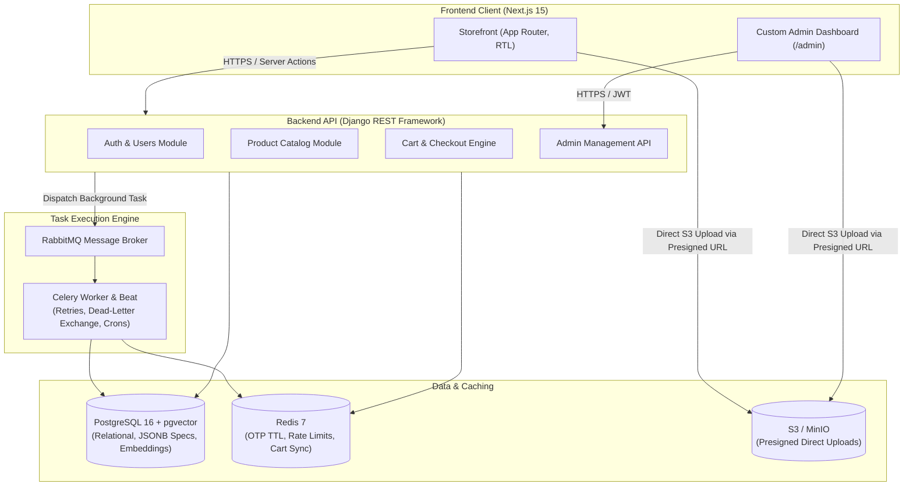

# Modern Full-Stack E-Commerce Specification & Roadmap

Transformed from legacy academic specification into modern production-ready distributed web application.

---

## 1. High-Level Architecture



---

## 2. Domain Model Schema (ERD)

Complete entity relationship diagram and schema definitions are maintained in a dedicated specification file:
👉 **[Detailed Entity Relationship Diagram (ERD.md)](./ERD.md)**

### Domain-Driven Design (DDD)

Use pragmatic DDD inside a **modular Django monolith**, not new microservices. [DDD guide](./docs/domain-driven-design.md) defines shared vocabulary, initial bounded contexts/ownership, aggregates/invariants, and implementation rules. The clusters below group entities for discussion; they are not aggregate or deployment boundaries.

- Separate identity/customers, catalog, ordering, payments, support, media, and notifications logically; create apps/modules only when implementing real use cases. Keep cross-context writes behind owning application services and imports acyclic.
- Django models protect local entity invariants; pure domain policies calculate decisions from explicit inputs/time. Application services coordinate loading, authorization, transactions/row locks, persistence, and follow-up work. APIs and Celery tasks dispatch those same use cases.
- Checkout retains shared PostgreSQL atomicity across catalog inventory and ordering state; DDD does not justify weakening stock concurrency. Preserve order snapshots/audit records and define cross-context deletion behavior explicitly.
- No duplicate ORM/domain entity hierarchies, generic repositories, speculative event bus, CQRS framework, or event sourcing. Use direct ORM and explicit calls first. After-commit callbacks avoid premature notifications but critical delivery requires durable recovery/idempotency.
- TASK-006 records architectural adoption. TASK-007 must resolve digital versus physical product semantics, currency/rounding, availability boundaries, and canonical payment/fulfillment/reservation behavior before catalog/checkout modeling. Existing scored rules remain in force until agreed changes update this document and ERD.
- Unit tests prove domain rules, integration tests prove transactions/context contracts, and E2E tests prove journeys. Implement one tested use case at a time; this document establishes conventions, not completed domain modules.

### Core Domain Clusters

| Domain Cluster | Primary Entities | Key Responsibilities |
| :--- | :--- | :--- |
| **Identity & Users** | `User`, `CustomerProfile`, `Address` | Phone-based auth, RBAC roles, customer profile metadata, delivery addresses. |
| **Shop Configuration** | `ShopSettings` (planned singleton) | Localized branding, landing content, navigation/contact/footer and metadata; later About content, not pricing/inventory/provider secrets. |
| **Catalog & Rules** | `Category`, `Product`, `Discount`, `StoreSchedule`, `ProductAvailabilityWindow`, `ProductLeadTimeRule`, `ProductAvailabilitySummary` | Hierarchical categories, dynamic JSONB specs, rule engines (even-day windows, lead times), precomputed summary table. |
| **Orders & Checkout** | `Order`, `OrderItem`, `Coupon`, `OrderAdjustment`, `OrderHistory`, `OrderVerificationCall` | Atomic stock reservation, coupon math, state machine, fulfillment queue reconciliation, operator verification. |
| **Customer Engagement** | `SavedProduct`, `ProductReview`, `ProductSubscription` | Wishlist bookmarks, verified buyer reviews & ratings, restock/price-drop notifications. |
| **Support & Policies** | `Ticket`, `TicketMessage`, `StorePolicy`, `EmailTemplate` | Order-linked ticketing threads, pgvector policy knowledge base, visual TinyMCE email templates. |

---

## 3. Requirements Matrix: Legacy vs Modern

| Feature Area | Original Academic Spec | Modern Production Spec |
| :--- | :--- | :--- |
| **Frontend** | Django Templates + Bootstrap + jQuery | Next.js 15 (App Router, React 19, TypeScript, Tailwind CSS, shadcn/ui, RTL support) |
| **Backend API** | Django DRF (Class-Based Views) | Django REST Framework (DRF) (ViewSets, Serializers, Permissions, Filters) |
| **Database** | SQLite dev / Postgres prod | PostgreSQL 16 (ACID, `JSONB` for attributes, `pgvector` for semantic search) |
| **Auth & Security** | Database-scanned OTP codes, standard Django session | Phone-based OTP in Redis (2m TTL), rate-limited by IP/phone, HTTP-only JWT cookies |
| **Cart & Checkout** | Session-based cart, raw creation without row locks | Client/Server synced cart, atomic DB transaction with `select_for_update` stock reservation |
| **Admin Panel** | Custom styled Django Admin templates | Dedicated custom Next.js `/admin` web application with strict RBAC |
| **Async Jobs** | Basic Celery + RabbitMQ | Celery + RabbitMQ with exponential backoff, DLQ, and scheduled Beat tasks |
| **File Storage** | Direct Django file upload or raw `boto3` in views | S3 presigned URL client uploads; zero media traffic through app server |
| **Testing** | Django test runner / Nose (legacy) | Pytest + factory-boy + pytest-django (Backend); Vitest + Playwright (Frontend) |

---

## 4. Engineering Phases

### Phase 0: Project Scaffolding & Infrastructure Foundations
**Goal**: Runnable local environment with unified container orchestration.
- **Docker Compose**:
  - `web`: Next.js 15 dev server.
  - `api`: Django REST Framework API server.
  - `postgres`: PostgreSQL 16 with `pgvector` extension.
  - `redis`: Redis 7 alpine.
  - `rabbitmq`: RabbitMQ 3.13 with management UI.
  - `worker`: Background task worker.
  - `minio`: S3-compatible local bucket.
- **Shared Standards**:
  - Follow layered [AGENTS.md](./AGENTS.md): readable names, cohesive modules, DRY business-rule ownership, minimal abstractions and relevant tests on every change. Scoped client/server/infra guides avoid loading unrelated context.
  - Model delivery includes permitted Next.js staff operations + protected API + tests. No Django admin UI/registrations; immutable history and derived data use safe inspection/actions. [Admin/settings contract](./docs/admin-and-shop-settings.md) defines acceptance.
  - Pre-commit hooks: Ruff (Python formatting/linting), ESLint + Prettier (TypeScript).
  - Git branching model: `main` (production), `develop` (staging), `feature/*` (work branches).
- **Deliverable**: `docker compose up` spins all services healthy. Healthcheck endpoints green.

---

### Phase 1: Core Domain, Identity, Customer & Support Module
**Goal**: Secure authentication, profile management, multi-address support, wishlist, and ticket desk.
- **Data Models**:
  - `BaseModel`: UUID primary key, `created_at`, `updated_at`, `deleted_at`, `is_active` (soft-delete with custom manager).
  - `User`: Phone number unique identifier, hashed password, role enum (`SUPERADMIN`, `PRODUCT_MANAGER`, `OPERATOR`, `AUDITOR`, `CUSTOMER`).
  - `CustomerProfile`: 1-to-1 with User, avatar URL, national code, age, gender.
  - `Address`: Province, city, postal code (10-digit regex), detailed body, recipient phone, default flag.
  - `SavedProduct` (Wishlist): Many-to-many link between Customer and Product with timestamp.
  - `Ticket` & `TicketMessage`: Support inquiries linked to customer and optional order reference; real-time messaging thread.
  - `ShopSettings` (TASK-108): one UUID-based row per deployment; constant singleton key with DB CHECK + UNIQUE, bootstrap migration, no delete/archive/deactivation, revision-based stale-write protection. Explicit localized branding/landing/contact/metadata fields and bounded validated link lists. Safe public projection and authorized Next.js `/admin/shop` editor; secrets remain environment configuration.
  - TASK-109 wires layout/landing/metadata to settings without redeploy (uncached initially); TASK-110 adds localized About page/editor later. Full planned fields/API/validation in [admin/settings contract](./docs/admin-and-shop-settings.md). No table/API/editor exists yet.
- **Auth Engine**:
  - Endpoint: `POST /api/v1/auth/otp/request` -> generates 6-digit code, saves in Redis with 120s TTL, applies sliding rate limit (max 3 requests per 10 minutes per IP/phone).
  - Endpoint: `POST /api/v1/auth/otp/verify` -> validates code atomically, issues JWT pair (short-lived access + rotating refresh token).
- **Internationalization (i18n & RTL)**:
  - Frontend support for Persian (`fa-IR`, RTL) and English (`en-US`, LTR).
- **Deliverable**: Test suite covering OTP generation, TTL expiry, rate limit rejection, address CRUD, wishlist toggling, and ticket message threads.

---

### Phase 2: Product Catalog, Reviews & Advanced Rules Engine
**Goal**: Flexible hierarchical catalog, dynamic attribute specs, customer reviews, stock alerts, and rule-based availability.
- **Data Models**:
  - `Category`: Self-referencing tree (`parent_id`, `slug`, `path`, `is_active`).
  - `Product`: Name, slug, brand, SKU, base price, stock count, `specifications` (`JSONB` column replacing rigid EAV tables), status (`DRAFT`, `PUBLISHED`, `ARCHIVED`).
  - `ProductReview`: 1 to 5 star rating, review title, detailed body, `is_verified_purchase` badge, approval status (`PENDING | APPROVED | REJECTED`).
  - `ProductSubscription`: Back-in-stock or price-drop notification subscriptions per user.
  - `Discount`:
    - Type: Percentage (with optional `max_discount_amount` ceiling) or Fixed Amount.
    - Scope: Product-level or Category-level.
    - Validity window: `starts_at` -> `expires_at`.
- **Special Business Rules (Challenging / Scored Constraints)**:
  - **Rule A (Time-Window Availability)**: Products configured to sell only on designated days/hours (e.g., even days 16:00-20:00). Stored in `ProductAvailabilityWindow`.
  - **Rule B (Advance Lead-Time Ordering)**: Products requiring advance ordering window relative to store schedule:
    - Condition 1: Must be ordered at least 3 hours before store closing time.
    - Condition 2: Must be ordered at least 10 hours before store opening time.
    - Stored in `StoreSchedule` and `ProductLeadTimeRule`.
  - **Summary Table Pattern**:
    - Precomputed in `ProductAvailabilitySummary` (`is_available_now`, `next_window_start`, `next_window_end`).
    - Eliminates multi-table joins on high-traffic catalog browsing.
    - Celery Beat scheduled task updates the summary cache periodically and whenever schedule/product rules mutate.
  - Encapsulate rules into pure domain service: `AvailabilityEngine.can_purchase(product, request_time) -> tuple[bool, str]`.
- **Media Upload**:
  - `POST /api/v1/media/presign-upload` -> returns signed S3 URL for client direct upload.
- **Deliverable**: Pytest tests validating category tree traversal, discount math with price capping, review submission & moderation, stock alert subscription, and availability rule edge cases.

---

### Parallel Learning Track: Three.js Material & Asset Previews

**Goal**: Help customers inspect PBR materials and 3D assets while learning Three.js through small, tested components. This presentation layer does not change catalog, inventory, checkout, or fulfillment rules.

- **Starter**: Native `three` with TypeScript, one opt-in material sphere, HTML color/roughness/metalness controls, orbit/reset, Persian/English labels, and a static sample when WebGL is unavailable.
- **Architecture**: Browser-only dynamic import under Next.js App Router; on-demand rendering; bounded pixel ratio; explicit GPU/listener/observer cleanup. Keep initial content and purchase controls independent of canvas.
- **Next components**: PBR texture inspector, catalog product preview, GLB turntable, then optional material comparison/shader exercises. Dependencies and acceptance criteria live in `TASK-3D-001` through `TASK-3D-006` in [tasks.md](./tasks.md).
- **Media boundary**: Future preview metadata and upload contracts require approved asset URLs, types, byte/resource limits, and attribution. Public preview derivatives must not expose protected source downloads. Use existing S3 presigned-upload architecture; no media streaming through Django.
- **Compatibility**: Web PBR approximates compatible exports, not arbitrary Unreal/HLSL/V-Ray/Corona shaders. No engine-equivalence claim.
- **Deliverable**: Working learning lab plus [source tour and exercises](./docs/threejs-learning.md). Production product previews require browser failure/recovery checks and measured mobile performance budgets before release.

---

### Phase 3: Cart, Checkout, Fulfillment Queue & Reconciliation
**Goal**: Race-condition-free ordering, stock protection, order fulfillment queue, out-of-stock item adjustment, and TinyMCE transactional emails.
- **Cart Architecture**:
  - Guest cart stored in client state / local storage.
  - Authenticated cart persisted in Redis (`cart:{user_id}`) for cross-device persistence.
  - Seamless merge on user login.
- **Data Models**:
  - `Coupon`: Unique code, percentage or fixed discount, usage limit, per-user usage limit, min order amount, validity window.
  - `Order`: Customer reference, snapshot delivery address, subtotal, discount amount, total price, payment status, fulfillment status.
  - `OrderItem`: Order reference, product reference, snapshot product title, snapshot unit price, quantity.
  - `OrderAdjustment`: Item removal / quantity decrement logs, unit price delta, refund amount, and reason.
  - `OrderHistory`: Comprehensive immutable audit trail of state transitions and item modifications with author logging.
  - `OrderVerificationCall`: Operator reference, call status (`PENDING`, `REACHED_CONFIRMED`, `UNREACHABLE`, `CANCELLED_BY_CUSTOMER`), operator notes, timestamp.
  - `EmailTemplate`: Dynamic TinyMCE HTML templates with placeholder variables (`{{customer_name}}`, `{{order_id}}`, `{{removed_items}}`, `{{refund_amount}}`).
- **Order State Machine**:
  ```mermaid
  stateDiagram-v2
      [*] --> UNPAID : Order Placed

      UNPAID --> PAYMENT_PENDING : User Selects Address & Initiates Pay
      PAYMENT_PENDING --> PAID : Webhook Confirmed (Stock Committed)
      PAYMENT_PENDING --> UNPAID : User Aborts Gateway
      PAYMENT_PENDING --> CANCELLED : 15m Expired (Celery Restores Stock)

      PAID --> CHECKING : Enters Operator Verification Queue
      CHECKING --> PROCESSING : Operator Phone Call Confirmed
      CHECKING --> CANCELLED : Customer Cancels During Call (Auto-Refund)
      CHECKING --> CHECKING : Customer Unreachable (Retry Scheduled)

      PROCESSING --> SHIPPED : Packed & Courier Assigned
      SHIPPED --> DELIVERED : Delivery Confirmed
      PAID --> REFUNDED : Admin / Customer Refund
      PROCESSING --> REFUNDED : Stock Defect / Cancellation

      DELIVERED --> [*]
      CANCELLED --> [*]
      REFUNDED --> [*]
  ```
- **Order Fulfillment Queue & Out-of-Stock Reconciliation Sequence**:
  ```mermaid
  sequenceDiagram
      autonumber
      participant Queue as Celery Fulfillment Queue
      participant Engine as OrderFulfillmentService
      participant PG as PostgreSQL (ACID)
      participant GW as Payment Gateway (Refund)
      participant Email as Celery Email Task (TinyMCE)

      Queue->>Engine: Process Order in PROCESSING status
      Engine->>PG: Lock Order & Check Stock
      alt Stock Deficient for OrderItem
          Engine->>PG: Remove/Decrement OrderItem & INSERT OrderAdjustment
          Engine->>PG: Recalculate Subtotal, Discount, Total Price
          Engine->>PG: INSERT OrderHistory ("Item removed due to out-of-stock")
          Engine->>GW: Execute Partial Refund API (refund_amount)
          Engine->>Email: Enqueue Task (Template: order_item_unavailable)
          Email->>Email: Render TinyMCE HTML with Context & Send
      else Stock Available
          Engine->>PG: Transition to SHIPPED
      end
  ```
- **Checkout & Concurrency Sequence**:
  ```mermaid
  sequenceDiagram
      autonumber
      actor Customer
      participant NextJS as Next.js Storefront
      participant API as Django REST Framework API
      participant PG as PostgreSQL (ACID)
      participant Redis as Redis Cache
      participant GW as Payment Gateway

      Customer->>NextJS: Click Checkout
      NextJS->>API: POST /api/v1/orders/checkout (items, address_id, coupon)
      
      rect rgb(240, 248, 255)
          Note over API,PG: Atomic Transaction + Row Lock
          API->>PG: BEGIN TRANSACTION
          API->>PG: SELECT stock FROM products WHERE id IN (...) FOR UPDATE
          alt Insufficient Stock
              API->>PG: ROLLBACK
              API-->>NextJS: 409 Conflict: Insufficient stock
          else Stock Available
              API->>PG: UPDATE products SET stock = stock - quantity
              API->>PG: INSERT INTO orders & order_items
              API->>PG: COMMIT
          end
      end

      API->>GW: Request Payment URL (order_id, amount)
      GW-->>API: payment_url + transaction_token
      API-->>NextJS: Redirect to Gateway (payment_url)
      Customer->>GW: Pay via Card / IPG

      GW->>API: POST /api/v1/payments/webhook (token, status, ref_id)
      API->>Redis: SETNX lock:payment:{token} (Prevent Replay)
      alt First Time Callback
          API->>PG: UPDATE orders SET payment_status = 'PAID'
          API-->>GW: 200 OK
      else Replay Duplicate Callback
          API-->>GW: 200 OK (Idempotent response)
      end
  ```
- **Atomic Checkout & Inventory Locking**:
  ```python
  # Core logic during order placement:
  with transaction.atomic():
      products = Product.objects.select_for_update().filter(id__in=item_ids)
      for item in items:
          if product.stock < item.quantity:
              raise InsufficientStockError()
          product.stock -= item.quantity
          product.save()
  ```
- **Payment Gateway Simulation**:
  - Idempotent payment callback handler (`POST /api/v1/payments/webhook`). Replay requests return cached response without double-charging or duplicate order fulfillment.
- **Deliverable**: Concurrency integration tests simulating parallel checkouts for the last item in stock. Exact 1 succeeds, others receive stock errors.

---

### Phase 4: Async Task Worker, Scheduling & Resilience
**Goal**: Reliable background processing with fault tolerance, dead-letter routing, and dedicated fulfillment queues.
- **Worker Configuration (RabbitMQ + Celery)**:
  - Task retry policy: exponential backoff with jitter (max 5 retries).
  - Dedicated Queues: `default`, `high_priority` (OTP SMS), `order_fulfillment` (inventory reconciliation & refunds), `emails` (TinyMCE template rendering).
  - Dead Letter Exchange (DLX) for poisoned messages.
- **Background Tasks**:
  - `send_otp_sms_task`: Sends SMS via provider gateway with failure retry.
  - `process_fulfillment_queue_task`: Checks batch orders in `PROCESSING`, reconciles out-of-stock items, executes partial refunds, and enqueues customer notifications.
  - `dispatch_transactional_email_task`: Renders TinyMCE template HTML with context data and delivers email via SMTP.
  - `notify_stock_subscribers_task`: Alerts customers when subscribed out-of-stock items are replenished or price drops occur.
  - `release_unpaid_orders_task`: Runs every 5 minutes. Cancels orders in `PAYMENT_PENDING` longer than 15 minutes and restores inventory stock atomically.
  - `clean_expired_data_task`: Scheduled daily cleanup of stale Redis keys, expired OTP records, and temp upload files.
- **Deliverable**: Unit and integration tests validating task retry behavior on mock network failure, DLQ routing, and fulfillment queue reconciliation.

---

### Phase 5: Custom Next.js Admin Panel (Role-Based Access Control)
**Goal**: Modern management console with granular staff access control.
- **RBAC Role Matrix (Scored Feature)**:
  ```mermaid
  graph LR
      subgraph StaffRoles["Staff Access Levels (Scored Feature)"]
          SA["Super Admin"]
          PM["Product Manager"]
          OP["Operator"]
          AU["Auditor (Supervisor)"]
      end

      subgraph AccessPermissions["Permission Scopes"]
          P_FULL["System-wide Full Control"]
          P_CAT["Products, Categories & Discounts (CRUD)"]
          P_ORD["Permitted Customer/Address Operations + Order Actions + Call Queue"]
          P_RO["Read-Only Across Entire System"]
      end

      SA --> P_FULL
      PM --> P_CAT
      OP --> P_ORD
      AU --> P_RO
  ```
- **Role Permissions Breakdown**:
  - **Super Admin**: System-wide permitted business operations, staff user management, shop settings and email template / policy configuration. Does not bypass audit immutability, singleton protections or order/payment invariants.
  - **Product Manager**: View, edit, delete, and create Products, Categories, Discounts, and Availability Windows. Review and moderate product reviews. No access to customer data or financial orders.
  - **Operator**: Manage permitted Customer/Address operations and explicit order business actions, phone verification and support ticket queues. No arbitrary order/payment state edits or paid-history deletion.
  - **Auditor (Supervisor)**: System-wide read-only view. Full visibility into metrics, orders, audit logs, and catalog with zero mutation privileges.
- **Key Views**:
  - Real-time order fulfillment kanban with telephone verification queue and adjustment logs.
  - Support ticket desk with multi-agent conversation threads and order linking.
  - Product review moderation console (approve, flag, reject).
  - Store policy knowledge-base manager (markdown editor for AI RAG ground truth).
  - TinyMCE visual email template builder with placeholder tag injector (`{{customer_name}}`, `{{order_id}}`).
  - Bulk inventory and price adjustment matrix.
  - Dynamic specification editor using JSON schema forms.
  - Store schedule and availability window manager.
- **Delivery timing**: build minimum authenticated staff shell with identity/auth before subsequent managed models, then add permitted screens with each model. Phase 5 completes specialist workflows/polish, not first-time administration. Django auth/permissions remain; Django admin app/routes/registrations are excluded.
- **Deliverable**: Server-side Next.js route authorization plus DRF role/object/use-case enforcement, with 403 Forbidden checks for direct requests; middleware/hidden buttons alone are insufficient. Editable models get usable CRUD/soft-delete/restore where safe; audit/derived/aggregate-child records use controlled actions/inspection. ShopSettings is detail/edit only, SUPERADMIN writes and AUDITOR reads.

---

### Phase 6: Practical AI Enhancements & Grounded Support Assistant
**Goal**: Real-world utility without infrastructure bloat.
- **Semantic Product Search**:
  - Product embeddings generated on create/update and stored in PostgreSQL `pgvector`.
  - Search endpoint: hybrid keyword (Postgres Full-Text Search) + vector similarity search.
- **Admin Catalog Auto-Enricher**:
  - Action inside custom admin: Provide brief product name + bullet specs -> LLM generates formatted Persian/English product description, SEO meta title, and category classification tags.
- **Grounded AI Support Assistant (Policy RAG + Human Ticket Fallback)**:
  - Admin publishes policies in `StorePolicy` (returns, shipping, guarantees).
  - Customer asks questions in storefront chat widget. System embeds query, queries top-k policy chunks using `pgvector`, and generates polite, grounded responses.
  - One-click ticket conversion: When question cannot be confidently answered or customer requests human help, conversation history converts automatically into a support `Ticket`.
  ```mermaid
  sequenceDiagram
      autonumber
      actor Customer
      participant Widget as AI Chat Widget
      participant API as Support AI Endpoint
      participant PG as PostgreSQL (pgvector StorePolicy)
      participant LLM as LiteLLM / OpenAI API
      participant Desk as Support Ticket System

      Customer->>Widget: Ask Question (e.g. "What is your refund policy?")
      Widget->>API: POST /api/v1/ai/chat (session_id, query)
      API->>PG: Query Top-K StorePolicy chunks by cosine similarity
      PG-->>API: Relevant Policy Markdown Excerpts
      API->>LLM: Generate friendly response grounded in policy excerpts
      alt LLM Confident from Policies
          LLM-->>API: Stream grounded friendly response
          API-->>Widget: Stream text response
      else Ambiguous / Customer Requests Agent
          API->>Desk: Convert conversation to Support Ticket
          API-->>Widget: "I've created support ticket #1042 for our team."
      end
  ```
- **Deliverable**: Search endpoint ranking relevant items ahead of exact keyword matches; admin generation action integrated; grounded policy chat widget functional with human ticket fallback.

---

### Phase 7: Quality Assurance, Hardening & Deployment
**Goal**: Production readiness, strict TDD methodology, and resilient performance benchmark.
- **Required Layers & Timing**:
  - Unit, integration, and E2E tests are all required. Integration tests prove component/service boundaries; E2E tests prove browser journeys. Neither replaces the other.
  - Add relevant tests during every feature phase; this phase completes coverage and release enforcement. TASK-005 establishes the harness early; TASK-701, TASK-705, and TASK-702 own unit, integration, and E2E gaps respectively.
  - Current implementation is partial: Vitest Three.js unit tests, PostgreSQL-backed BaseModel tests, and health endpoint tests with mocked dependency checks exist. Playwright dependency/configuration and automated E2E tests do not yet exist. Manual browser smoke checks are not an E2E suite.
- **Test-Driven Development (TDD) Strategy**:
  - Red-Green-Refactor enforced across domain engines. Cover normal, boundary, invalid-input, and failure behavior.
  - Target: Minimum 85% backend coverage across unit/integration tests; report client coverage and define its threshold under TASK-701. Critical assertions and E2E journeys remain required regardless of coverage percentage.
- **Test Matrix** (future filenames below are illustrative, not claims of existing files):
  - **Unit Tests — Pytest / Vitest**:
    - `test_discounts.py`: Pure discount/coupon calculations with percentage caps, fixed amounts, and expiry boundaries.
    - `test_availability.py`: Isolated time-window and lead-time calculations with controlled time; persistence/cache invalidation belongs in integration tests.
    - Pure order transition and template substitution rules; client validation/cart logic as introduced.
    - Three.js scene construction, material values, owned resource disposal, and preview error notification without a GPU.
  - **Integration Tests — Pytest / DRF APIClient + Isolated Services**:
    - Existing `server/tests/test_base_model.py`: Real PostgreSQL persistence, UUID/defaults, soft-delete manager filtering, restore, and cascade behavior.
    - API request validation, auth/RBAC/ownership, status codes, response schema, and persisted changes; mocked health checks do not prove live DB/Redis connectivity.
    - `test_checkout_concurrency.py`: Real transactions with 10 concurrent requests for last stock item; exactly one commits, nine receive 409 Conflict; verify rollback on failure.
    - `test_payment_idempotency.py`: Real Redis atomic locks plus PostgreSQL updates; callback replays cannot double-charge or fulfill twice.
    - Redis OTP TTL, single-use verification, rate limits, cart merge; summary invalidation after rule mutations; JSONB/pgvector queries.
    - Worker retry/idempotency and broker delivery behavior, test storage/presigned upload policy; isolate third-party payment/refund/SMS/email via controlled adapters.
  - **E2E Browser Automation — Playwright**:
    - Run real browser against running Next.js, Django, and isolated services with deterministic seeds; mocked API browser tests are supplemental, not proof of full-stack journeys.
    - Purchase flow: Guest adds to cart -> OTP login -> Address -> Coupon -> Checkout -> Test gateway callback; assert persisted order outcome.
    - Availability rejection outside allowed window, RBAC denial for direct routes/API, and ownership protection.
    - Persian/English RTL/LTR, Shamsi/Gregorian dates, localized currency, mobile layout, and keyboard-accessible purchase controls.
    - Three.js opt-in load, material controls/reset, unsupported WebGL, lost context/retry, and close/reopen; coordinate with TASK-3D-006. Development Strict Mode gets a separate browser regression check.
- **Isolation & Release Gates**:
  - PostgreSQL test DB only; never SQLite. Use isolated Redis keys/database and test storage, deterministic time/data, and cleanup. Never use production data or trigger real charges/messages.
  - Run unit/integration checks, lint, typecheck, and browser E2E in CI with coverage reports and browser failure traces/screenshots. Missing dependencies must fail clearly; record unrun checks rather than claim success.
  - Current root `npm run test` runs Vitest then Pytest, not E2E. Separate layer commands, discovery/markers, Playwright install/configuration, service startup, seed/reset, and CI wiring remain TASK-005 / TASK-701 / TASK-702 work.
- **Load Testing**:
  - Locust test verifying 500 RPM on checkout endpoints under load.
- **Production Container Build**:
  - Multi-stage Dockerfiles for minimal production image footprint.
  - Reverse proxy: NGINX / Caddy with TLS termination, gzip/brotli compression, and security headers.
